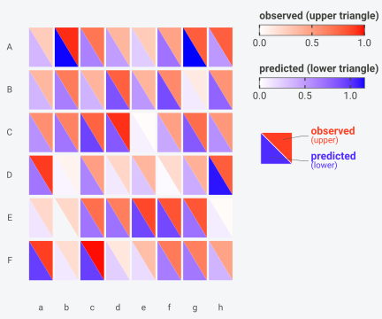
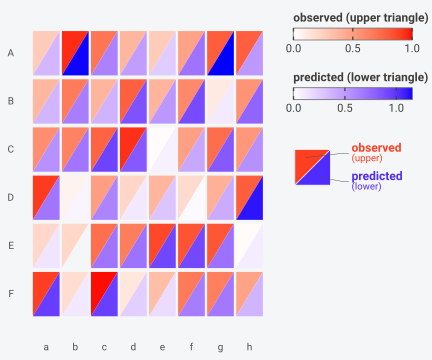
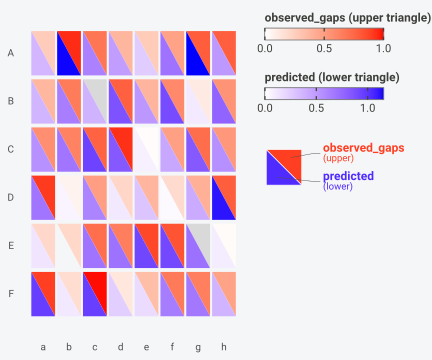
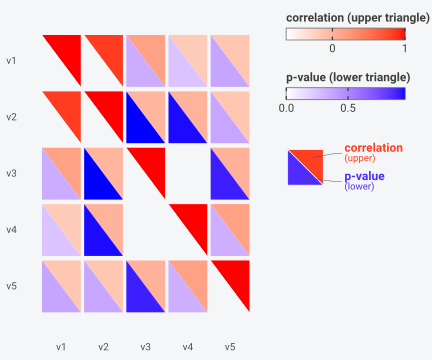
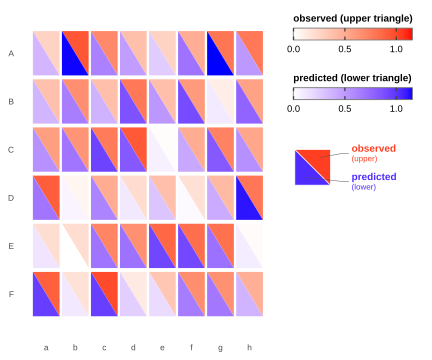
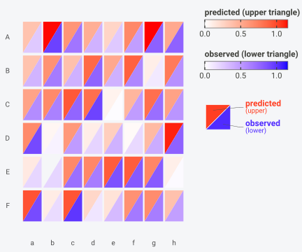
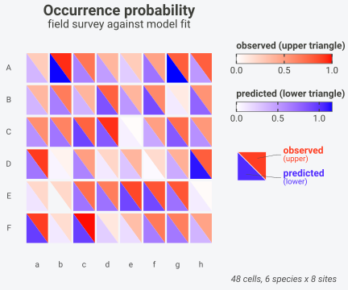

# Getting started with BiHeat

``` r

library(BiHeat)
```

## Two matrices, one plot

BiHeat draws a heatmap where every cell is cut along a diagonal. The
upper triangle carries a value from one matrix, the lower triangle
carries the value from the same position in a second matrix.

Here are species occurrence probabilities across sites, observed and
predicted by some model:

``` r

set.seed(1)
species   <- LETTERS[1:6]
sites     <- letters[1:8]
observed  <- matrix(runif(48), 6, 8, dimnames = list(species, sites))
predicted <- observed + matrix(rnorm(48, sd = 0.15), 6, 8,
                               dimnames = list(species, sites))

biheat(observed, predicted)
```



Each cell holds both numbers at once. A cell whose two halves are
similarly pale, or similarly saturated, is a cell where the model agreed
with the data. A cell with a deep half against a washed-out half is a
cell where it did not. The comparison happens inside one cell, at the
resolution of a single species at a single site, without the eye
travelling between two panels.

The pairing generalises past observed and predicted. Mean and variance,
correlation and p-value, train and test accuracy, model A and model B,
richness before and after: any two numeric matrices sharing a shape are
candidates.

## Reading a split cell

Three things carry information in the panel, and it helps to know which
one you are reading.

Within a single cell, the contrast between the two halves is the
comparison. A cell whose halves differ sharply is a disagreement between
the two matrices at that row and column. This is the reading the split
makes cheap, because both values occupy one spot and the eye needs no
saccade between panels.

Down a column or across a row, the variation within one triangle is the
gradient of that matrix. The upper triangles of a row read as a small
heatmap of their own, and so do the lower ones.

Across the two palettes, colour is a label rather than a quantity. Red
and blue carry no relative meaning, so a saturated red half and a
saturated blue half say that both values are high in their own matrix,
not that they are equal.

That last point is where `scale` matters. Under the default
`"separate"`, each triangle spans its own range, so the halves of a cell
cannot be compared as numbers, only as positions within their own
matrix. Under `"shared"` they span one range and a visible mismatch
inside a cell is a real numeric difference.

The diagonal direction changes which halves sit next to each other. With
`split = "down"` the upper triangles of horizontally adjacent cells meet
across the cell boundary, which favours reading along rows.
`split = "up"` favours reading down columns. Neither changes the data,
and switching between them is worth doing when the panel is meant to
support one direction of comparison.

``` r

biheat(observed, predicted, split = "up")
```



## The clutch

[`biheat()`](https://gillescolling.com/BiHeat/reference/biheat.md)
renders in one call. Underneath it runs a three-stage lifecycle that you
can also drive yourself, and the object in the middle of it carries more
than the two matrices.

``` r

clutch <- breed(observed, predicted)
clutch
#> <clutch>
#>   upper: observed (6 x 8)
#>   lower: predicted (6 x 8)
#>   align: intersect  (6 rows x 8 cols kept)
#>   cells: 48 finite / 48 total (0 NA)
#>   pearson: 0.911   rmse: 0.136   mae: 0.104
```

[`breed()`](https://gillescolling.com/BiHeat/reference/breed.md) returns
a `clutch`. It aligned the two matrices, counted the usable cells, and
computed the comparison statistics that the print method reports:
Pearson and Spearman correlation, RMSE, and MAE. Those sit in
`clutch$meta` alongside the value range of each side:

``` r

str(clutch$meta)
#> List of 10
#>  $ n_cells     : int 48
#>  $ n_finite    : int 48
#>  $ n_na        : int 0
#>  $ upper_range : num [1:2] 0.0134 0.9919
#>  $ lower_range : num [1:2] -0.000584 1.154483
#>  $ shared_range: num [1:2] -0.000584 1.154483
#>  $ pearson     : num 0.911
#>  $ spearman    : num 0.914
#>  $ rmse        : num 0.136
#>  $ mae         : num 0.104
```

Nothing about the drawing has happened yet. A clutch is the paired data
plus what BiHeat learned about the pair, which makes it worth keeping
around even when the plot is not the immediate goal:

``` r

round(clutch$meta$spearman, 3)
#> [1] 0.914
round(clutch$meta$rmse, 3)
#> [1] 0.136
```

Anything [`as.matrix()`](https://rdrr.io/r/base/matrix.html) can turn
into a numeric matrix is accepted, so a pair of all-numeric data frames
needs no conversion first:

``` r

breed(as.data.frame(observed), as.data.frame(predicted))
#> <clutch>
#>   upper: as.data.frame(observed) (6 x 8)
#>   lower: as.data.frame(predicted) (6 x 8)
#>   align: intersect  (6 rows x 8 cols kept)
#>   cells: 48 finite / 48 total (0 NA)
#>   pearson: 0.911   rmse: 0.136   mae: 0.104
```

A non-numeric input stops the call rather than coercing silently:

``` r

breed(matrix(letters[1:6], 2, 3), matrix(1:6, 2, 3))
#> Error:
#> ! `a` must be a numeric matrix.
```

The labels on the legend come from the symbols you passed in.
`breed(observed, predicted)` recorded `"observed"` and `"predicted"` by
reading the call, so the two colourbars name themselves. Pass
`upper_name` and `lower_name` when the variables are called something
less presentable.

``` r

breed(observed, predicted,
      upper_name = "field survey",
      lower_name = "model fit")
#> <clutch>
#>   upper: field survey (6 x 8)
#>   lower: model fit (6 x 8)
#>   align: intersect  (6 rows x 8 cols kept)
#>   cells: 48 finite / 48 total (0 NA)
#>   pearson: 0.911   rmse: 0.136   mae: 0.104
```

## How the two matrices get aligned

Two matrices that came from different pipelines rarely arrive with their
rows and columns in the same order, or even with the same rows and
columns.
[`breed()`](https://gillescolling.com/BiHeat/reference/breed.md) handles
that before anything is drawn, so a mismatch shows up as a message about
your data rather than as a plot that quietly compares the wrong cells.

The default, `align = "intersect"`, works on dimnames. When both
matrices carry row names, BiHeat keeps the rows present in both; the
same rule applies to columns.

``` r

a <- matrix(runif(12), 3, 4,
            dimnames = list(c("x", "y", "z"), c("s1", "s2", "s3", "s4")))
b <- matrix(runif(12), 3, 4,
            dimnames = list(c("y", "z", "w"), c("s2", "s3", "s4", "s5")))

breed(a, b)
#> <clutch>
#>   upper: a (2 x 3)
#>   lower: b (2 x 3)
#>   align: intersect  (2 rows x 3 cols kept)
#>   dropped: 2 rows, 2 cols
#>   cells: 6 finite / 6 total (0 NA)
#>   pearson: -0.821   rmse: 0.463   mae: 0.376
```

Two rows and two columns went away, and the clutch says so. The detail
of which labels were dropped, and from which side, sits in
`align_report`:

``` r

str(breed(a, b)$align_report)
#> List of 7
#>  $ mode          : chr "intersect"
#>  $ rows_kept     : int 2
#>  $ cols_kept     : int 3
#>  $ rows_dropped_a: chr "x"
#>  $ rows_dropped_b: chr "w"
#>  $ cols_dropped_a: chr "s1"
#>  $ cols_dropped_b: chr "s5"
```

An axis where only one matrix carries names, or where neither does, is
matched by position instead, which requires the two lengths to agree.
`align = "by_position"` skips the name logic entirely and pairs cell
`[i, j]` with cell `[i, j]`:

``` r

u <- matrix(runif(6), 2, 3)
l <- matrix(runif(6), 2, 3)
breed(u, l, align = "by_position")
#> <clutch>
#>   upper: u (2 x 3)
#>   lower: l (2 x 3)
#>   align: by_position  (2 rows x 3 cols kept)
#>   cells: 6 finite / 6 total (0 NA)
#>   pearson: -0.676   rmse: 0.357   mae: 0.296
```

Two failures stop the call rather than guessing. Matrices of different
shapes with no names to align on:

``` r

breed(matrix(1:6, 2, 3), matrix(1:12, 3, 4))
#> Error:
#> ! Matrices have different dimensions (2x3 vs 3x4); cannot align by position.
```

And named matrices whose names have nothing in common:

``` r

breed(
  matrix(1:6, 2, 3, dimnames = list(c("a", "b"), c("x", "y", "z"))),
  matrix(1:6, 2, 3, dimnames = list(c("c", "d"), c("x", "y", "z")))
)
#> Error:
#> ! No overlapping row names between `a` and `b`.
```

## Missing cells

A gap in one matrix belongs to one triangle. BiHeat keeps the cell,
draws the half it has, and fills the missing half with `na_colour`:

``` r

observed_gaps <- observed
observed_gaps[2, 3] <- NA
observed_gaps[5, 7] <- NA

gappy <- breed(observed_gaps, predicted)
gappy
#> <clutch>
#>   upper: observed_gaps (6 x 8)
#>   lower: predicted (6 x 8)
#>   align: intersect  (6 rows x 8 cols kept)
#>   cells: 46 finite / 48 total (2 NA)
#>   pearson: 0.913   rmse: 0.138   mae: 0.106
```

The cell count separates the two quantities: 48 cells exist, and the
number reported as finite is how many have a value on both sides. The
correlation, RMSE, and MAE use that subset. Two grey half-cells appear
in the panel:

``` r

plot(gappy, na_colour = "grey85")
```



## Separate and shared colour scales

Each triangle gets its own colour range by default, which is what you
want when the two matrices measure different things. A correlation
matrix paired with the p-values of those correlations is the clearest
case: one side lives on `[-1, 1]`, the other on `[0, 1]`, and forcing
them onto a common range would waste most of both palettes.

``` r

set.seed(42)
m <- matrix(rnorm(200), 40, 5, dimnames = list(NULL, paste0("v", 1:5)))
m[, 2] <- m[, 1] * 0.8 + rnorm(40, sd = 0.6)
m[, 4] <- m[, 3] * -0.5 + rnorm(40, sd = 0.8)

cmat <- cor(m)
pmat <- outer(seq_len(5), seq_len(5),
              Vectorize(function(i, j) stats::cor.test(m[, i], m[, j])$p.value))
dimnames(pmat) <- dimnames(cmat)

biheat(cmat, pmat, upper_name = "correlation", lower_name = "p-value")
```


`scale = "shared"` puts both triangles on one range, which is what makes
a cross-triangle comparison mean something. Observed against predicted
qualifies, since both are probabilities in the same units:

``` r

biheat(observed, predicted, scale = "shared")
```



The choice changes the reading of the same data. Under `"separate"`,
each side is stretched across its own minimum and maximum, so a pale
upper half means low *relative to the other observed values*. Under
`"shared"`, the same pale half means low relative to everything in both
matrices, and a visible difference between the two halves of one cell is
a real difference in probability. The observed and predicted matrices
here differ by 0.136 RMSE, which is small enough that the shared version
looks close to symmetric.

## The lifecycle

`biheat(observed, predicted, scale = "shared")` is sugar. Written out,
it is:

``` r

breed(observed, predicted) |>
  incubate(scale = "shared") |>
  plot()
```



[`incubate()`](https://gillescolling.com/BiHeat/reference/incubate.md)
records rendering options on the clutch and hands it back, so calls
layer the way ggplot2’s `+` does. Splitting one call into several
changes nothing:

``` r

breed(observed, predicted) |>
  incubate(scale = "shared") |>
  incubate(split = "up") |>
  incubate(show_values = TRUE, value_size = 2.4) |>
  plot()
```


Options are stored, not validated on the spot, so a partial
configuration is allowed to exist. Validation happens when
[`plot()`](https://rdrr.io/r/graphics/plot.default.html) reads the
config:

``` r

breed(observed, predicted) |>
  incubate(scale = "sheared") |>
  plot()
#> Error in `match.arg()`:
#> ! 'arg' should be one of "separate", "shared"
```

A configured clutch prints its config, which is a quick way to see what
a long pipeline has accumulated:

``` r

breed(observed, predicted) |>
  incubate(scale = "shared", split = "up", show_values = TRUE)
#> <clutch>
#>   upper: observed (6 x 8)
#>   lower: predicted (6 x 8)
#>   align: intersect  (6 rows x 8 cols kept)
#>   cells: 48 finite / 48 total (0 NA)
#>   pearson: 0.911   rmse: 0.136   mae: 0.104
#>   config: scale=shared, split=up, show_values=TRUE
```

[`plot()`](https://rdrr.io/r/graphics/plot.default.html) takes rendering
options too, treating them as one final
[`incubate()`](https://gillescolling.com/BiHeat/reference/incubate.md)
pass. These three lines draw the same figure:

``` r

biheat(observed, predicted, split = "up")
breed(observed, predicted) |> incubate(split = "up") |> plot()
breed(observed, predicted) |> plot(split = "up")
```

## Verbs

Four verbs take a clutch and return a clutch, which is what lets them
chain.

[`switch_sides()`](https://gillescolling.com/BiHeat/reference/switch_sides.md)
exchanges the two matrices, along with their names and ranges.
[`straighten()`](https://gillescolling.com/BiHeat/reference/straighten.md)
flips the diagonal between `"down"` and `"up"`.
[`bothways()`](https://gillescolling.com/BiHeat/reference/bothways.md)
toggles between separate and shared scales, or takes the value outright.

``` r

breed(observed, predicted) |>
  switch_sides() |>
  straighten() |>
  bothways() |>
  plot()
```



`predicted` is now on top, the diagonal runs the other way, and the
scale is shared. Each verb reads the current state and moves it one
step, so calling
[`bothways()`](https://gillescolling.com/BiHeat/reference/bothways.md)
twice returns to where it started:

``` r

breed(observed, predicted) |> bothways() |> bothways()
#> <clutch>
#>   upper: observed (6 x 8)
#>   lower: predicted (6 x 8)
#>   align: intersect  (6 rows x 8 cols kept)
#>   cells: 48 finite / 48 total (0 NA)
#>   pearson: 0.911   rmse: 0.136   mae: 0.104
#>   config: scale=separate
```

[`comes_out()`](https://gillescolling.com/BiHeat/reference/comes_out.md)
goes the other direction and returns the per-cell table:

``` r

cells <- comes_out(breed(observed, predicted))
head(cells)
#> <biheat_data> 6 cells (6 x 8)
#>   upper = observed
#>   lower = predicted
#>   row col i j     upper     lower
#> 1   A   a 1 1 0.2655087 0.3584825
#> 2   B   a 2 1 0.3721239 0.3637046
#> 3   C   a 3 1 0.5728534 0.5494840
#> 4   D   a 4 1 0.9082078 0.6875949
#> 5   E   a 5 1 0.2016819 0.1299594
#> 6   F   a 6 1 0.8983897 0.9610809
```

One row per cell, with the matrix indices, the labels, and both values.
That table is what
[`geom_biheat()`](https://gillescolling.com/BiHeat/reference/geom_biheat.md)
consumes, and it is a convenient starting point for questions the
heatmap is not the right shape for:

``` r

cells$error <- cells$lower - cells$upper
head(cells[order(-abs(cells$error)), c("row", "col", "upper", "lower", "error")], 4)
#> <biheat_data> 4 cells (0 x 0)
#>   upper = 
#>   lower = 
#>    row col     upper     lower      error
#> 37   A   g 0.7942399 1.1544825  0.3602427
#> 46   D   h 0.7893562 1.1152480  0.3258918
#> 32   B   f 0.5995658 0.8966258  0.2970600
#> 43   A   h 0.7829328 0.5121890 -0.2707438
```

[`comes_out()`](https://gillescolling.com/BiHeat/reference/comes_out.md)
also accepts a plot that BiHeat drew, so the data is recoverable from
the figure:

``` r

p <- biheat(observed, predicted)
identical(comes_out(p), comes_out(breed(observed, predicted)))
#> [1] TRUE
```

## What plot() hands back

The default return is a `biheat_plot`, a gtable holding the panel and
the paired legend with its split-tile key glyph:

``` r

class(biheat(observed, predicted))
#> [1] "biheat_plot" "gtable"      "gTree"       "grob"        "gDesc"
```

It prints like any plot and
[`ggplot2::ggsave()`](https://ggplot2.tidyverse.org/reference/ggsave.html)
accepts it. ggplot2’s `+` works on ggplot objects, and a gtable is not
one, so adding a component to a rendered BiHeat plot returns `NULL`:

``` r

class(biheat(observed, predicted) + ggplot2::labs(title = "observed vs predicted"))
#> [1] "NULL"
```

That is how ggplot2 treats any gtable, including one from
[`ggplot2::ggplotGrob()`](https://ggplot2.tidyverse.org/reference/ggplotGrob.html).
Titles, labels, and every other rendering option go through
[`incubate()`](https://gillescolling.com/BiHeat/reference/incubate.md)
or the `...` of
[`biheat()`](https://gillescolling.com/BiHeat/reference/biheat.md)
instead:

``` r

biheat(observed, predicted,
       title = "Occurrence probability",
       subtitle = "field survey against model fit",
       caption = "48 cells, 6 species x 8 sites")
```


Turning the key glyph off leaves nothing to inject, and the underlying
ggplot comes back instead. That object does take `+`:

``` r

p_gg <- biheat(observed, predicted, show_key = FALSE)
class(p_gg)
#> [1] "ggplot2::ggplot" "ggplot"          "ggplot2::gg"     "S7_object"      
#> [5] "gg"

p_gg + ggplot2::theme(legend.position = "bottom")
```



## Sizing the panel

The legend column holds two colourbars and the key glyph at fixed
centimetre sizes, and measures about 4.65 cm whatever the figure
dimensions. The panel takes what is left, so the width available for
cells is the figure width minus that column and the axis labels.

A 7 inch wide figure is 17.8 cm, leaving roughly 12 cm of panel. Spread
over 8 columns that is 1.5 cm per cell, and over 30 columns it is 4 mm,
at which point a cell is a pair of small triangles and the tick labels
have started to overlap. Two ways to buy width back:

``` r

# move the legend under the panel
biheat(observed, predicted, legend_position = "bottom")

# drop the key glyph, keeping the colourbars
biheat(observed, predicted, show_key = FALSE)
```

`show_values = TRUE` needs considerably more room, since two numbers
have to fit inside one cell. It stays legible to roughly 8 columns at
the default figure width. Lowering `value_size` fits a few more columns
in, at smaller type.

## When the split cell works

The design assumes the two matrices are worth looking at together, cell
by cell. Cases where it earns its place:

- The two matrices are the same measurement under two conditions, and
  the question is where they disagree. Observed against predicted,
  before against after, two models scored on one grid.
- One matrix qualifies the other, as a correlation does with its
  p-value, so each cell is a value plus its trustworthiness.
- The grid is small enough that individual cells are meant to be read.
  Up to a few hundred cells the split is legible; past that the panel
  reads as texture and two side-by-side heatmaps show the broad pattern
  more directly.

Cases where something else fits better:

- Three or more matrices. The cell has two halves, and a facet over a
  long table handles the rest.

- One matrix, where a plain
  [`ggplot2::geom_tile()`](https://ggplot2.tidyverse.org/reference/geom_tile.html)
  is simpler.

- Matrices whose interesting structure is the ordering itself, where a
  clustered heatmap with dendrograms does work BiHeat does not attempt.

The comparison statistics on the clutch are a check on the last point. A
pair with a Pearson correlation near 1 and a small RMSE will draw as an
almost symmetric panel, and the figure then has little to show:

``` r

c(pearson = round(clutch$meta$pearson, 3),
  rmse    = round(clutch$meta$rmse, 3),
  mae     = round(clutch$meta$mae, 3))
#> pearson    rmse     mae 
#>   0.911   0.136   0.104
```

## Where to go next

- [`vignette("styling")`](https://gillescolling.com/BiHeat/articles/styling.md)
  covers palettes, values printed in cells, cell geometry, row and
  column ordering, legend placement, and the theme.
- [`vignette("geom-biheat")`](https://gillescolling.com/BiHeat/articles/geom-biheat.md)
  covers the ggplot2 layer, which draws the same split cells from a long
  data frame and leaves the `fill` scale free for other layers.
