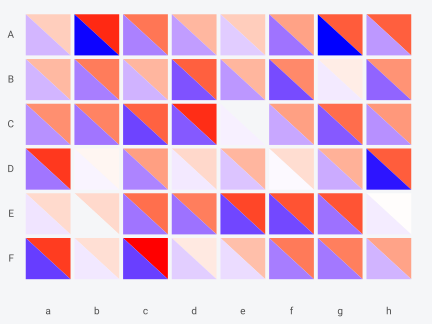
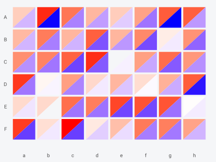
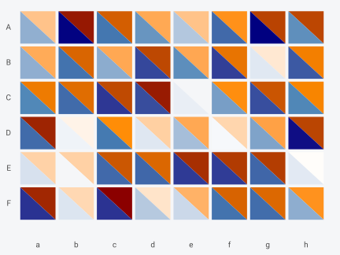
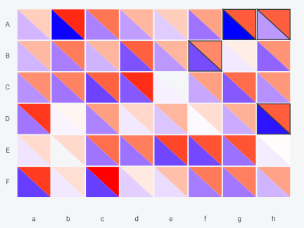
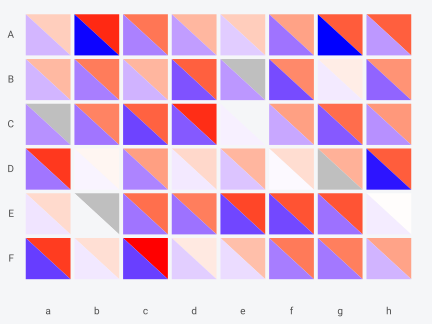
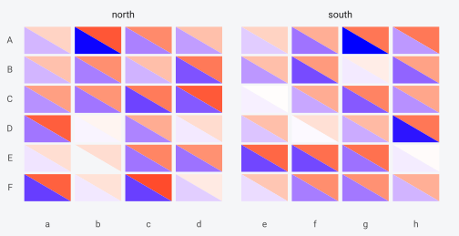
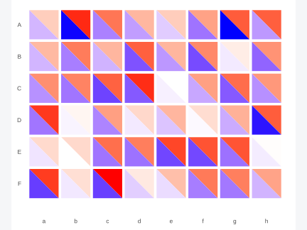
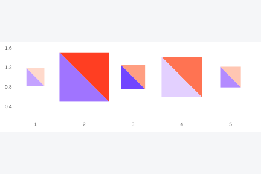
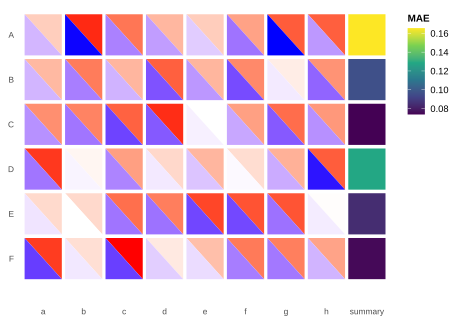
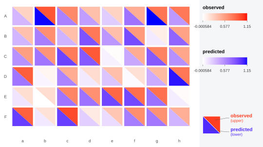

# Split cells inside a ggplot

## Installation

``` r

# install.packages("remotes")
remotes::install_github("gcol33/BiHeat")
```

``` r

library(BiHeat)
library(ggplot2)
```

[`biheat()`](https://gillescolling.com/BiHeat/reference/biheat.md) takes
two matrices and returns a finished figure.
[`geom_biheat()`](https://gillescolling.com/BiHeat/reference/geom_biheat.md)
draws the same split cells as a ggplot2 layer, from a long data frame,
inside a plot you build yourself. Faceting, coordinate systems, other
layers, and any theme are then available in the usual way.

## The data shape

The layer wants one row per cell, with the two values in their own
columns:

``` r

set.seed(1)
species   <- LETTERS[1:6]
sites     <- letters[1:8]
observed  <- matrix(runif(48), 6, 8, dimnames = list(species, sites))
predicted <- observed + matrix(rnorm(48, sd = 0.15), 6, 8,
                               dimnames = list(species, sites))

cells <- comes_out(breed(observed, predicted))
head(cells)
#> <biheat_data> 6 cells (6 x 8)
#>   upper = observed
#>   lower = predicted
#>   row col i j     upper     lower
#> 1   A   a 1 1 0.2655087 0.3584825
#> 2   B   a 2 1 0.3721239 0.3637046
#> 3   C   a 3 1 0.5728534 0.5494840
#> 4   D   a 4 1 0.9082078 0.6875949
#> 5   E   a 5 1 0.2016819 0.1299594
#> 6   F   a 6 1 0.8983897 0.9610809
```

[`comes_out()`](https://gillescolling.com/BiHeat/reference/comes_out.md)
is a convenient source when the data started as matrices, and any long
table works. Reshaping from two matrices by hand takes one call:

``` r

manual <- expand.grid(site = sites, species = species,
                      stringsAsFactors = FALSE)
manual$observed  <- as.vector(t(observed))
manual$predicted <- as.vector(t(predicted))
head(manual, 3)
#>   site species  observed predicted
#> 1    a       A 0.2655087 0.3584825
#> 2    b       A 0.9446753 1.1484772
#> 3    c       A 0.6870228 0.6278794
```

## Four required aesthetics

`x`, `y`, `upper`, and `lower` are required. The first two place the
cell, the last two fill its triangles:

``` r

ggplot(cells, aes(col, row, upper = upper, lower = lower)) +
  geom_biheat() +
  theme_biheat()
```



Rows come out in the alphabetical order a discrete axis gives them,
running bottom to top. Reversing the factor levels puts the first
species at the top, matching the matrix layout
[`biheat()`](https://gillescolling.com/BiHeat/reference/biheat.md)
produces:

``` r

cells$site    <- factor(cells$col, levels = sites)
cells$species <- factor(cells$row, levels = rev(species))

ggplot(cells, aes(site, species, upper = upper, lower = lower)) +
  geom_biheat() +
  theme_biheat()
```


`split` flips the diagonal, as it does elsewhere in BiHeat:

``` r

ggplot(cells, aes(site, species, upper = upper, lower = lower)) +
  geom_biheat(split = "up") +
  theme_biheat()
```



## Colour ranges

The layer carries its own pair of palettes and maps values to colours
itself. Each triangle is stretched across the range of its own data by
default, which is the `scale = "separate"` behaviour of
[`biheat()`](https://gillescolling.com/BiHeat/reference/biheat.md).
`upper_range` and `lower_range` set those ranges explicitly, and passing
the same range to both gives a shared scale:

``` r

shared <- range(c(cells$upper, cells$lower))

ggplot(cells, aes(site, species, upper = upper, lower = lower)) +
  geom_biheat(upper_range = shared, lower_range = shared) +
  theme_biheat()
```



Fixing the ranges is what makes several panels comparable. Facets
computed from the data alone would each get their own range, and a cell
in one panel would then mean something different from the same colour in
the next.

Values outside a supplied range are clamped to the nearest end rather
than dropped, so a range chosen for the bulk of the data still draws
every cell.

Palettes work as they do in
[`incubate()`](https://gillescolling.com/BiHeat/reference/incubate.md),
taking a
[`palettes()`](https://gillescolling.com/BiHeat/reference/palettes.md)
object or a bare vector with `lower_palette`:

``` r

ggplot(cells, aes(site, species, upper = upper, lower = lower)) +
  geom_biheat(palettes = palettes(c("white", "darkorange", "darkred"),
                                  c("white", "steelblue", "navy"))) +
  theme_biheat()
```


## Cell geometry and outlines

`cell_inset` opens a gap between neighbours, and `colour` with
`linewidth` outlines each triangle. Both are the same controls
[`incubate()`](https://gillescolling.com/BiHeat/reference/incubate.md)
exposes, and `colour` is an aesthetic here, so it can vary per cell:

``` r

ggplot(cells, aes(site, species, upper = upper, lower = lower)) +
  geom_biheat(cell_inset = 0, colour = "white", linewidth = 0.4) +
  theme_biheat()
```



The full set of aesthetics:

| Aesthetic | Role |
|----|----|
| `x`, `y` | Cell centre. Required. |
| `upper`, `lower` | The two values. Required. |
| `width`, `height` | Cell footprint. Defaults to the resolution of the positions. |
| `colour`, `linewidth`, `linetype` | Triangle outline. |
| `alpha` | Triangle opacity. |

`colour`, `linewidth`, `linetype`, and `alpha` behave as they do in any
ggplot2 layer, settable as constants in the call or mapped through
[`aes()`](https://ggplot2.tidyverse.org/reference/aes.html). The fills
are the exception, since the layer resolves them from `upper` and
`lower` against the palettes rather than through a scale.

Mapping `colour` marks a subset without disturbing the fills:

``` r

cells$flagged <- abs(cells$upper - cells$lower) > 0.25

ggplot(cells, aes(site, species, upper = upper, lower = lower)) +
  geom_biheat(aes(colour = flagged), cell_inset = 0.02, linewidth = 0.6) +
  scale_colour_manual(values = c(`TRUE` = "black", `FALSE` = NA),
                      guide = "none") +
  theme_biheat()
```



## Missing values

A missing value belongs to one triangle. The layer keeps the cell, draws
the half it has, and fills the other with `na_colour`. Only a missing
position drops a cell entirely.

``` r

gappy <- cells
gappy$upper[c(3, 11, 26)] <- NA
gappy$lower[40] <- NA

ggplot(gappy, aes(site, species, upper = upper, lower = lower)) +
  geom_biheat(na_colour = "grey75") +
  theme_biheat()
```


## Faceting

Faceting is the reason to reach for the layer. Splitting a model
comparison by group, with a range fixed across panels so the colours
mean the same thing in each:

``` r

cells$region <- ifelse(cells$col %in% letters[1:4], "north", "south")

ggplot(cells, aes(site, species, upper = upper, lower = lower)) +
  geom_biheat(upper_range = shared, lower_range = shared) +
  facet_wrap(~region, scales = "free_x") +
  theme_biheat()
```



[`coord_fixed()`](https://ggplot2.tidyverse.org/reference/coord_fixed.html)
keeps the cells square whatever the panel dimensions:

``` r

ggplot(cells, aes(site, species, upper = upper, lower = lower)) +
  geom_biheat() +
  coord_fixed() +
  theme_biheat()
```



## Continuous axes

Nothing requires a discrete axis. With numeric `x` and `y` the cell
footprint comes from the resolution of the positions, which is the
smallest gap between them, so cells stay square and evenly sized however
the positions are spread.

`width` and `height` override that per cell, which lets the footprint
carry a third variable. Sizing each cell by how much data went into it:

``` r

transects <- data.frame(
  x     = c(1, 2, 3, 4, 5),
  y     = rep(1, 5),
  upper = c(0.2, 0.9, 0.5, 0.7, 0.3),
  lower = c(0.4, 0.6, 0.8, 0.2, 0.5),
  n     = c(5, 40, 12, 30, 8)
)

ggplot(transects, aes(x, y, upper = upper, lower = lower)) +
  geom_biheat(aes(width = 0.3 + n / 50, height = 0.3 + n / 50),
              upper_range = c(0, 1), lower_range = c(0, 1)) +
  coord_fixed() +
  theme_biheat()
```



The two small cells came from a handful of observations, and the split
inside them is worth less than the split inside the large ones. The
ranges are anchored at `c(0, 1)` here rather than left to the data,
which keeps the smallest value off the white end of each palette; a
triangle drawn in the palette’s first colour is easy to mistake for an
absent one. A continuous axis also lets cells sit at real coordinates,
so a grid of sites with known positions keeps its geometry.

## Layers on top

The cells are polygons in a normal panel, so anything else can be drawn
over them. Labelling the cells where the two matrices disagree most:

``` r

worst <- cells[order(-abs(cells$upper - cells$lower)), ][1:5, ]
worst$gap <- round(worst$upper - worst$lower, 2)

ggplot(cells, aes(site, species, upper = upper, lower = lower)) +
  geom_biheat() +
  geom_text(data = worst, aes(site, species, label = gap),
            size = 2.8, fontface = "bold", inherit.aes = FALSE) +
  theme_biheat()
```


[`geom_point()`](https://ggplot2.tidyverse.org/reference/geom_point.html),
[`geom_segment()`](https://ggplot2.tidyverse.org/reference/geom_segment.html),
and annotations work the same way. Setting `inherit.aes = FALSE` on the
added layer keeps it from inheriting `upper` and `lower`, which it has
no use for.

## The fill scale stays free

Neither triangle consumes ggplot2’s `fill` scale, which leaves it for
another layer. Here a column of per-species mean error sits beside the
heatmap, on its own continuous fill scale:

``` r

margin <- data.frame(
  site    = factor("summary", levels = c(levels(cells$site), "summary")),
  species = factor(species, levels = rev(species)),
  mae     = as.vector(tapply(abs(cells$upper - cells$lower), cells$row, mean))
)
cells$site <- factor(cells$col, levels = levels(margin$site))

ggplot(mapping = aes(site, species)) +
  geom_biheat(data = cells, aes(upper = upper, lower = lower)) +
  geom_tile(data = margin, aes(fill = mae), width = 0.92, height = 0.92) +
  scale_fill_viridis_c(name = "MAE") +
  theme_biheat()
```



The same freedom applies to `colour`, `size`, and any other scale the
layer does not touch, so points, labels, and segments can be added over
the cells.

## Layer plumbing

`stat` and `position` are the standard ggplot2 layer arguments and
default to `"identity"`, which is what a heatmap wants: one row of data
becomes one cell, at the position given. `data` and `mapping` behave as
in any layer, so several
[`geom_biheat()`](https://gillescolling.com/BiHeat/reference/geom_biheat.md)
calls can draw different subsets with different palettes in one panel.

`show.legend` is accepted for consistency with other layers. Since the
fills never pass through a scale there is no key for ggplot2 to draw,
which is why
[`bi_legend()`](https://gillescolling.com/BiHeat/reference/bi_legend.md)
exists.

Each cell becomes two polygons of three vertices, so a 50 by 50 grid is
5,000 polygons and 15,000 vertices. That draws quickly to a raster
device, and vector output grows with the same count, so an SVG or PDF of
a large grid gets heavy. Rasterising just this layer is worth
considering past a few thousand cells.

## A legend of your own

[`geom_biheat()`](https://gillescolling.com/BiHeat/reference/geom_biheat.md)
draws no legend, since the colours never pass through a scale.
[`bi_legend()`](https://gillescolling.com/BiHeat/reference/bi_legend.md)
builds the paired key as a standalone grob, and base grid places it next
to the panel:

``` r

panel <- ggplot(cells, aes(site, species, upper = upper, lower = lower)) +
  geom_biheat(upper_range = shared, lower_range = shared) +
  theme_biheat()

key <- bi_legend("observed", "predicted",
                 upper_range = shared,
                 lower_range = shared)

grid::grid.newpage()
grid::pushViewport(grid::viewport(
  layout = grid::grid.layout(1, 2, widths = grid::unit(c(1, 4.6),
                                                       c("null", "cm")))
))
grid::pushViewport(grid::viewport(layout.pos.col = 1))
grid::grid.draw(ggplotGrob(panel))
grid::popViewport()
grid::pushViewport(grid::viewport(layout.pos.col = 2))
grid::grid.draw(key)
grid::popViewport(2)
```



Pass
[`bi_legend()`](https://gillescolling.com/BiHeat/reference/bi_legend.md)
the same ranges the layer used and the ticks describe the colours on
screen. Its `split` argument should match the layer’s, so the glyph
shows the diagonal that was drawn.

## Which entry point

[`biheat()`](https://gillescolling.com/BiHeat/reference/biheat.md)
covers the case where two matrices go in and one figure comes out, with
alignment, comparison statistics, and the legend handled.
[`geom_biheat()`](https://gillescolling.com/BiHeat/reference/geom_biheat.md)
covers everything that needs the rest of ggplot2: facets, a second
layer, a coordinate system, a theme applied across a set of figures, or
a panel that is one piece of a larger composition.

The practical differences:

|  | [`biheat()`](https://gillescolling.com/BiHeat/reference/biheat.md) | [`geom_biheat()`](https://gillescolling.com/BiHeat/reference/geom_biheat.md) |
|----|----|----|
| Input | Two matrices | One long data frame |
| Alignment on dimnames | Done by [`breed()`](https://gillescolling.com/BiHeat/reference/breed.md) | Yours to do |
| Comparison statistics | On the clutch | Compute from the table |
| Colour ranges | `scale = "separate"` or `"shared"` | `upper_range`, `lower_range` |
| Legend | Drawn, with the key glyph | [`bi_legend()`](https://gillescolling.com/BiHeat/reference/bi_legend.md), placed by you |
| Return | A gtable, or a ggplot without the key | Always a ggplot layer |
| Facets, extra layers, coords | Through `show_key = FALSE` | Directly |

Going from matrices to the layer takes one call, since
[`comes_out()`](https://gillescolling.com/BiHeat/reference/comes_out.md)
returns exactly the table the layer wants. A workflow can start with
[`biheat()`](https://gillescolling.com/BiHeat/reference/biheat.md) for a
first look, then move to the layer when the figure needs facets or a
companion panel.

They share the drawing code, so a plot built either way puts the same
triangles in the same places.

## Where to go next

- [`vignette("biheat")`](https://gillescolling.com/BiHeat/articles/biheat.md)
  covers the clutch, alignment, and the lifecycle.

- [`vignette("styling")`](https://gillescolling.com/BiHeat/articles/styling.md)
  covers palettes, cell geometry, ordering, and the legend as
  [`incubate()`](https://gillescolling.com/BiHeat/reference/incubate.md)
  options.
