# Styling and layout

## Installation

``` r

# install.packages("remotes")
remotes::install_github("gcol33/BiHeat")
```

``` r

library(BiHeat)

set.seed(1)
species   <- LETTERS[1:6]
sites     <- letters[1:8]
observed  <- matrix(runif(48), 6, 8, dimnames = list(species, sites))
predicted <- observed + matrix(rnorm(48, sd = 0.15), 6, 8,
                               dimnames = list(species, sites))
```

Every option on this page is an argument to
[`incubate()`](https://gillescolling.com/BiHeat/reference/incubate.md).
[`biheat()`](https://gillescolling.com/BiHeat/reference/biheat.md)
forwards its `...` to the same place, and
[`plot()`](https://rdrr.io/r/graphics/plot.default.html) accepts them as
a final pass, so the three forms below are interchangeable and this
vignette mixes them freely.

``` r

biheat(observed, predicted, cell_inset = 0.1)
breed(observed, predicted) |> incubate(cell_inset = 0.1) |> plot()
breed(observed, predicted) |> plot(cell_inset = 0.1)
```

## Palettes

The two triangles carry two gradients.
[`palettes()`](https://gillescolling.com/BiHeat/reference/palettes.md)
bundles them, taking a character vector of two or more colours per side,
which
[`scales::gradient_n_pal()`](https://scales.r-lib.org/reference/pal_gradient_n.html)
interpolates across.

``` r

palettes(c("white", "darkorange", "darkred"),
         c("white", "steelblue", "navy"))
#> <palettes>
#>   upper: white -> darkorange -> darkred
#>   lower: white -> steelblue -> navy
```

``` r

biheat(observed, predicted,
       palettes = palettes(c("white", "darkorange", "darkred"),
                           c("white", "steelblue", "navy")))
```

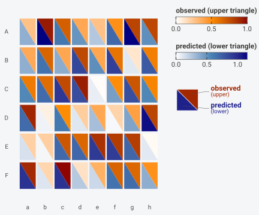

A bare character vector is read as the upper palette, with
`lower_palette` as its companion, which saves a call when both sides are
simple ramps:

``` r

biheat(observed, predicted,
       palettes = c("grey95", "forestgreen"),
       lower_palette = c("grey95", "purple4"))
```

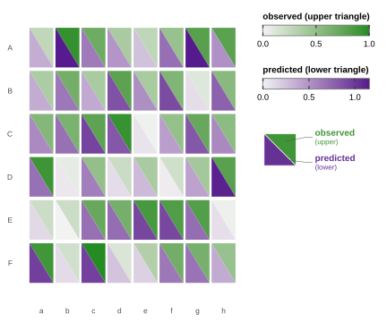

Three or more stops give a diverging ramp, which suits a matrix centred
on zero. Residuals are the usual case:

``` r

residual <- predicted - observed
biheat(observed, residual,
       upper_name = "observed",
       lower_name = "residual",
       palettes = palettes(c("white", "grey20"),
                           c("steelblue", "white", "firebrick")))
```

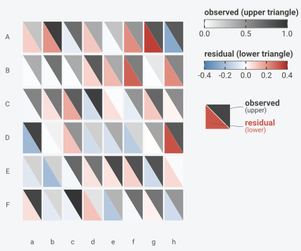

The colour a value lands on depends on the range the palette is
stretched across, which `scale` controls.
[`vignette("biheat")`](https://gillescolling.com/BiHeat/articles/biheat.md)
covers the choice between `"separate"` and `"shared"`.

### Choosing a pair

Two properties matter more here than in a single-scale heatmap, because
the two palettes have to be told apart inside one cell.

The two hues need to stay separable. The default red and blue remain
distinguishable under the common red-green colour deficiencies, and a
green paired with a red does not. Orange with purple, and green with
purple, both hold up as alternatives.

Both ramps should start from a similar lightness. Anchoring each at
white or a pale grey means a cell whose halves are both pale reads as
two low values rather than as one low value beside a differently
coloured one, and the split stays visible only where it carries
information.

``` r

biheat(observed, predicted,
       palettes = palettes(c("grey97", "#E66100"),
                           c("grey97", "#5D3A9B")))
```

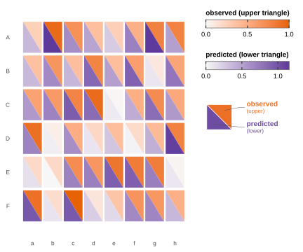

Ramps that start dark work when the panel is dense enough that pale
cells would disappear, at the cost of making low values the loudest
thing in the figure.

## Printing the values

`show_values = TRUE` writes each number inside its own triangle, at two
significant digits:

``` r

biheat(observed[, 1:5], predicted[, 1:5], show_values = TRUE)
```

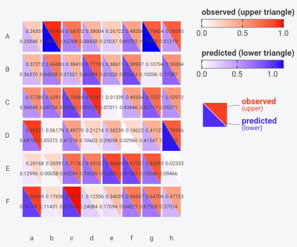

Labels are sized in millimetres by `value_size`, the same unit
[`ggplot2::geom_text()`](https://ggplot2.tidyverse.org/reference/geom_text.html)
uses. The default of 3 suits a panel of roughly this size; a denser grid
needs a smaller number, and the labels start to collide somewhere past
10 columns at the default figure width.

``` r

biheat(observed, predicted, show_values = TRUE, value_size = 2.1)
```


## Cell geometry

`cell_inset` shrinks every cell on all four sides, as a fraction of its
width and height. The default of `0.04` leaves a thin gap that keeps
neighbouring cells legible. `0` makes the grid contiguous:

``` r

biheat(observed, predicted, cell_inset = 0)
```


Larger values pull the cells apart, which reads well when the individual
comparison matters more than the pattern across the panel:

``` r

biheat(observed, predicted, cell_inset = 0.15)
```

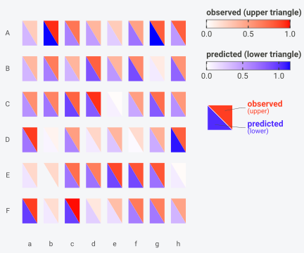

The argument accepts anything in `[0, 0.5)`, and `0.5` would shrink a
cell to nothing.

Outlines are separate from the gap. `grid_colour` draws a border around
each triangle and `grid_linewidth` sets its weight, so a contiguous grid
can still show its cut lines:

``` r

biheat(observed, predicted,
       cell_inset = 0,
       grid_colour = "white",
       grid_linewidth = 0.6)
```

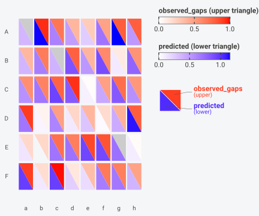

Both default to nothing drawn (`NA` colour at width `0`). Outlining
every triangle on a large matrix costs legibility, so a fine linewidth
pays off past a few hundred cells.

## Missing cells

A cell missing a value on one side keeps its other half, and the gap
takes `na_colour`:

``` r

observed_gaps <- observed
observed_gaps[2, 3] <- NA
observed_gaps[5, 7] <- NA
observed_gaps[1, 1] <- NA

biheat(observed_gaps, predicted, na_colour = "grey80")
```

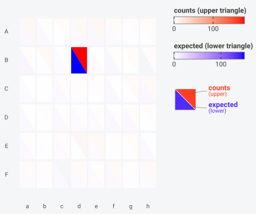

The default is `"grey90"`. Something further from the palettes in use
makes an absent value harder to misread as a low one, which matters most
when a palette starts at white.

## Skewed values

Each palette is stretched linearly across its range, so one extreme
value compresses everything else into the pale end. A matrix of counts
usually has this shape:

``` r

set.seed(7)
counts <- matrix(rpois(48, lambda = 3), 6, 8,
                 dimnames = list(species, sites))
counts[2, 4] <- 180

expected <- matrix(rpois(48, lambda = 3), 6, 8,
                   dimnames = list(species, sites))
expected[2, 4] <- 150

biheat(counts, expected)
```


One cell holds the top of both scales and the other 47 sit near the
bottom. BiHeat has no transform argument, since transforming the matrix
before [`breed()`](https://gillescolling.com/BiHeat/reference/breed.md)
does the job and keeps what was plotted explicit:

``` r

biheat(log1p(counts), log1p(expected),
       upper_name = "log1p(counts)",
       lower_name = "log1p(expected)")
```

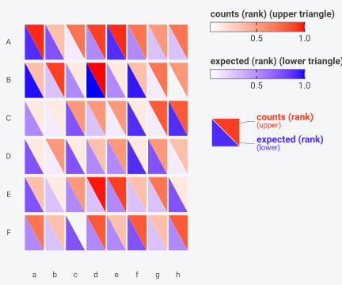

Ranking is the other option when only the ordering matters, and it puts
both matrices on the same bounded scale as a side effect:

``` r

rank_matrix <- function(m) {
  out <- matrix(rank(m, na.last = "keep"), nrow(m), ncol(m),
                dimnames = dimnames(m))
  out / max(out, na.rm = TRUE)
}

biheat(rank_matrix(counts), rank_matrix(expected),
       scale = "shared",
       upper_name = "counts (rank)",
       lower_name = "expected (rank)")
```

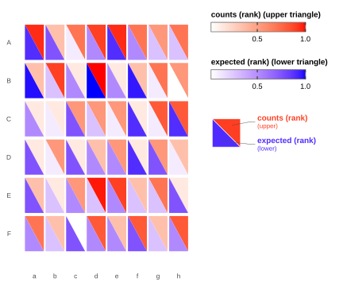

The colourbar labels report the transformed numbers under either
approach, which is why both examples above set `upper_name` and
`lower_name` to say so.

## Ordering rows and columns

Rows are drawn top to bottom and columns left to right, in the order
they carry after
[`breed()`](https://gillescolling.com/BiHeat/reference/breed.md) aligned
them. `row_order` and `col_order` take a permutation of those labels and
rearrange the panel.

Sorting by something computed from the data is the useful case. Here the
species with the largest mean absolute error move to the top:

``` r

cells <- comes_out(breed(observed, predicted))
mae_by_species <- tapply(abs(cells$upper - cells$lower), cells$row, mean)
worst_first <- names(sort(mae_by_species, decreasing = TRUE))
round(sort(mae_by_species, decreasing = TRUE), 3)
#>     A     D     B     E     F     C 
#> 0.165 0.128 0.096 0.085 0.075 0.074
```

``` r

biheat(observed, predicted, row_order = worst_first)
```

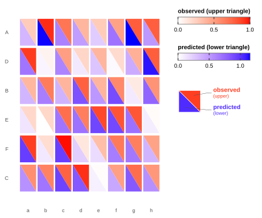

Column order works the same way, and the two combine:

``` r

site_totals <- colMeans(observed)
biheat(observed, predicted,
       row_order = worst_first,
       col_order = names(sort(site_totals, decreasing = TRUE)))
```


Both arguments require a full permutation of the labels, so a partial
vector stops the call and every row stays in the panel:

``` r

biheat(observed, predicted, row_order = c("A", "B"))
#> Error:
#> ! `row_order` must be a permutation of the clutch's row labels.
```

## The legend

`legend_position` takes `"right"` (the default), `"bottom"`, or
`"none"`. `legend_orientation` controls whether the two colourbars stack
or sit side by side.

``` r

biheat(observed, predicted,
       legend_position = "bottom",
       legend_orientation = "horizontal")
```

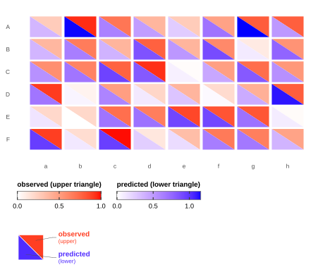

Below the two bars sits the key glyph: a split tile showing which
triangle belongs to which name, with a callout to each. It follows the
`split` setting, so it always matches the diagonal drawn in the panel.
`show_key = FALSE` drops it, which is worth doing for a small multiple
where the same key would repeat:

``` r

biheat(observed, predicted, show_key = FALSE)
```

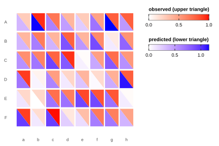

Dropping the key also changes the return type. With no glyph to inject,
the underlying ggplot comes back rather than a gtable, and that object
accepts ggplot2’s `+`:

``` r

biheat(observed, predicted, show_key = FALSE) +
  ggplot2::theme(legend.position = "bottom")
```

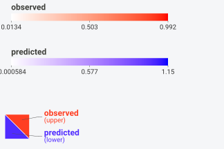

`legend_position = "none"` removes the legend and the key together.

[`bi_legend()`](https://gillescolling.com/BiHeat/reference/bi_legend.md)
builds the same paired legend as a standalone grob, for figures where
the panel is assembled somewhere else:

``` r

grid::grid.draw(
  bi_legend("observed", "predicted",
            upper_range = range(observed),
            lower_range = range(predicted),
            split = "down")
)
```


Its ranges are yours to supply, so a legend can be shared across several
panels by passing the pooled range to all of them.

## Titles and axis labels

`title`, `subtitle`, and `caption` behave the way they do anywhere in
ggplot2.
[`theme_biheat()`](https://gillescolling.com/BiHeat/reference/theme_biheat.md)
centres the first two and italicises the caption:

``` r

biheat(observed, predicted,
       title = "Occurrence probability",
       subtitle = "field survey against model fit",
       caption = "6 species x 8 sites")
```

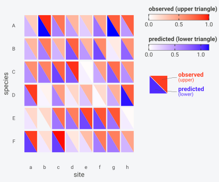

Axis titles are blank by default, since the tick labels usually name the
axis on their own. Supplying `xlab` or `ylab` switches that axis title
back on:

``` r

biheat(observed, predicted, xlab = "site", ylab = "species")
```


`upper_name` and `lower_name` override the labels on the colourbars and
in the key glyph.
[`breed()`](https://gillescolling.com/BiHeat/reference/breed.md) reads
them from the symbols you passed, so they only need setting when the
variable names are unhelpful:

``` r

biheat(observed, predicted,
       upper_name = "field survey",
       lower_name = "model fit",
       show_key = FALSE)
```

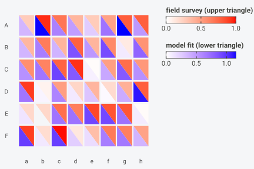

## The theme

[`theme_biheat()`](https://gillescolling.com/BiHeat/reference/theme_biheat.md)
is a
[`ggplot2::theme_minimal()`](https://ggplot2.tidyverse.org/reference/ggtheme.html)
with the panel grid, background, axis ticks, and axis titles removed,
tick labels laid horizontally, and the legend keyed to the left. It is
applied for you inside
[`plot()`](https://rdrr.io/r/graphics/plot.default.html), and exported
for use with
[`geom_biheat()`](https://gillescolling.com/BiHeat/reference/geom_biheat.md).

`base_size` scales the whole thing:

``` r

library(ggplot2)
#> Warning: package 'ggplot2' was built under R version 4.6.1

cells$site    <- factor(cells$col, levels = sites)
cells$species <- factor(cells$row, levels = rev(species))

ggplot(cells, aes(site, species, upper = upper, lower = lower)) +
  geom_biheat() +
  theme_biheat(base_size = 15)
```

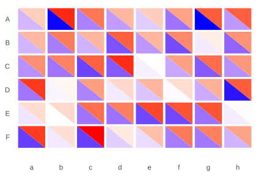

`base` swaps the theme underneath, which keeps the heatmap adjustments
while changing everything else:

``` r

ggplot(cells, aes(site, species, upper = upper, lower = lower)) +
  geom_biheat() +
  theme_biheat(base = theme_dark(base_size = 11))
```

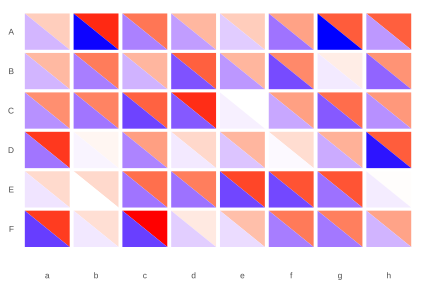

## Keeping a set of figures consistent

Several BiHeat panels in one document need the same options, and the
readable way to do that is a configured clutch rather than a repeated
argument list.
[`incubate()`](https://gillescolling.com/BiHeat/reference/incubate.md)
is additive, so a shared configuration can be applied first and the
per-figure options added after:

``` r

house_style <- function(clutch) {
  incubate(clutch,
           palettes = palettes(c("grey97", "#E66100"),
                               c("grey97", "#5D3A9B")),
           cell_inset = 0.06,
           legend_position = "bottom",
           legend_orientation = "horizontal")
}

house_style(breed(observed, predicted)) |> plot(title = "Panel A")
house_style(breed(observed, residual))  |> plot(title = "Panel B")
```

Colours only mean the same thing across panels if the ranges match, and
`scale = "shared"` shares a range between the two triangles of one
figure rather than across figures. Matching across figures means fixing
the range yourself, which the clutch route does not expose;
[`geom_biheat()`](https://gillescolling.com/BiHeat/reference/geom_biheat.md)
takes `upper_range` and `lower_range` for exactly this, and
[`vignette("geom-biheat")`](https://gillescolling.com/BiHeat/articles/geom-biheat.md)
covers it.

## Saving

[`ggplot2::ggsave()`](https://ggplot2.tidyverse.org/reference/ggsave.html)
accepts a `biheat_plot` gtable as it does a ggplot:

``` r

p <- biheat(observed, predicted, title = "Occurrence probability")
ggplot2::ggsave("biheat.png", p, width = 7, height = 5.5, dpi = 300)
ggplot2::ggsave("biheat.pdf", p, width = 7, height = 5.5)
```

Give the figure room. The legend column holds two colourbars and the key
glyph at fixed centimetre sizes, so a width under about 5 inches
squeezes the panel rather than the legend. Moving the legend to the
bottom buys back the width.

## Where to go next

- [`vignette("biheat")`](https://gillescolling.com/BiHeat/articles/biheat.md)
  covers the clutch, alignment, and the lifecycle.

- [`vignette("geom-biheat")`](https://gillescolling.com/BiHeat/articles/geom-biheat.md)
  covers the ggplot2 layer for panels you assemble yourself.
